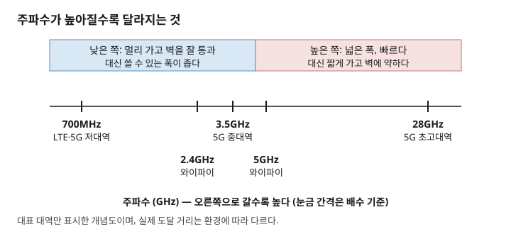
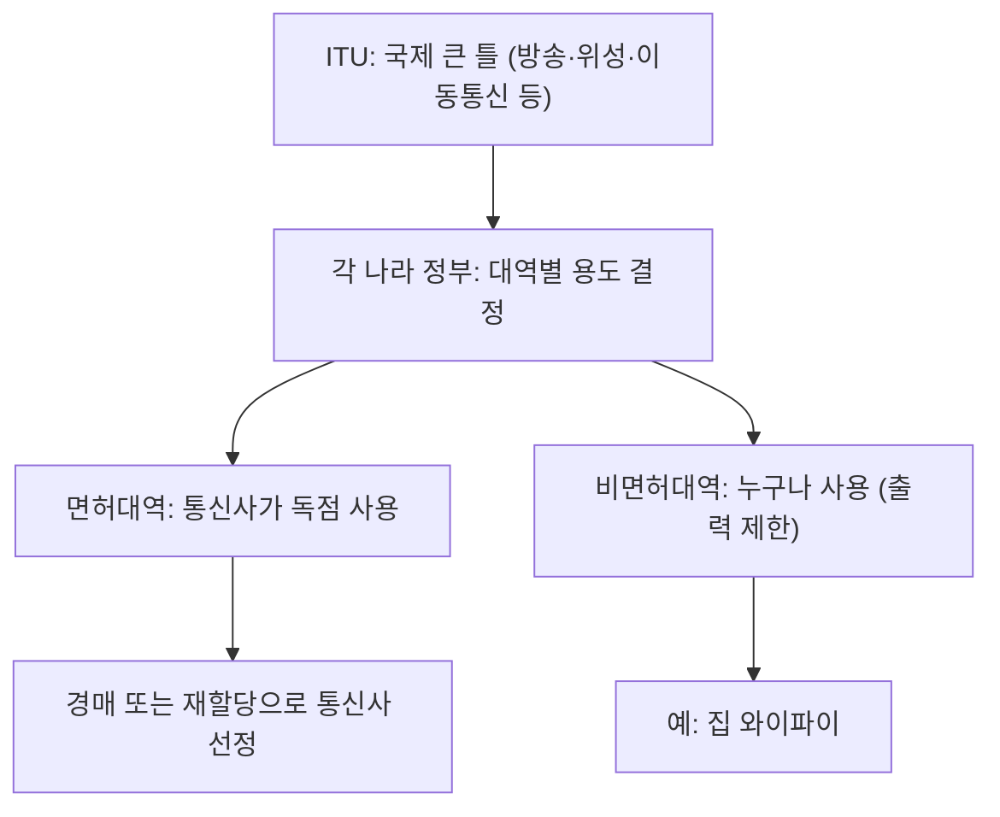

# 주간 통신 브리핑 — 2026-10-13

> 이번 주 배울 것: 주파수 대역마다 성질이 다른 이유와, 그 대역을 국가가 나눠주는 이유를 이해합니다.

*참고: 직전 리포트가 2026-09-22 자라 3주 공백이 있었습니다. 그 사이 소식 중 날짜가 확인된 것만 담았습니다.*

## 0. 30초 요약

- 낮은 주파수는 멀리 가고 벽을 잘 통과합니다. 대신 쓸 수 있는 폭이 좁습니다.
- 높은 주파수는 넓은 폭을 쓰므로 빠릅니다. 대신 짧게 가고 벽에 약합니다.
- 전파는 모두가 함께 쓰는 한정된 자원입니다. 그래서 국가가 용도와 사용자를 정해 나눠줍니다.
- 이번 주 뉴스: 삼성전자가 KT·SK텔레콤과 AI 기지국 사업 계약을 맺었습니다. 3GPP는 6G 표준 작업이 첫 규격 단계로 가고 있다고 정리했습니다.

## 1. 지난주 복습

지난 리포트에서는 주파수와 대역폭을 배웠습니다.
주파수는 전파가 1초에 몇 번 출렁이는지를 센 숫자입니다.
대역폭은 통신에 쓰는 주파수 범위의 폭이고, 넓을수록 한 번에 많은 데이터를 보냅니다.

**확인 문제**: "5G가 LTE보다 빠른 이유 중 하나"를 대역폭으로 설명해 보세요.
정답: 5G는 폭 100MHz 정도를 쓰고, LTE는 20MHz 정도를 씁니다. 폭이 넓어 더 많이 담습니다. (지난 리포트 3절 참고)

---

## 2. 이번 주 개념 ① — 주파수 대역별 성질

### 문제부터
통신사는 700MHz도 쓰고 3.5GHz도 쓰고 28GHz도 씁니다.
그냥 가장 빠른 대역 하나만 쓰면 될 텐데, 왜 여러 개를 섞어 쓸까요?
대역마다 장단점이 달라서, 하나로는 "멀리"와 "빠르게"를 동시에 얻지 못하기 때문입니다.

### 정의
주파수 대역별 성질이란, 주파수에 따라 전파의 도달 거리가 달라지는 특징입니다. 장애물을 만났을 때의 행동도 달라집니다.
기지국 하나가 덮는 범위를 **커버리지(coverage, 신호가 닿는 범위)**라 합니다.
같은 시간에 실어 나르는 총 데이터 양을 **용량(capacity)**이라 합니다.
낮은 대역은 커버리지에 유리하고, 높은 대역은 용량에 유리합니다.

### 동작 원리
먼저 비유 하나입니다. 낮은 북소리는 벽 너머에서도 들리지만, 높은 호루라기 소리는 벽에 막혀 잘 안 들립니다.
이제 실제 원리입니다. 전파가 퍼져 나가면 에너지가 넓은 공간에 흩어집니다.
같은 크기의 안테나로 받으면, 주파수가 높을수록 받는 에너지가 더 줄어듭니다.
주파수가 2배가 되면 받는 힘은 약 4분의 1이 됩니다.
또 파장이 긴 낮은 주파수는 장애물을 돌아 휘어 들어가는 성질이 강합니다.
파장이 짧은 높은 주파수는 벽에 반사되거나 흡수되어 버립니다.
그런데 낮은 대역은 이미 여러 서비스가 차지해 빈 폭이 좁습니다.
높은 대역에는 넓은 폭이 비어 있습니다. 지난주에 배운 대로 폭이 넓으면 빠릅니다.

**이 그림에서 볼 것**: 왼쪽 파란 영역은 멀리 가는 대역이고, 오른쪽 붉은 영역은 빠르지만 짧게 가는 대역입니다.

### 체감 사례
지하 주차장이나 엘리베이터에서도 통화가 되는 것은 낮은 대역이 벽을 뚫어 주는 덕분입니다.
집 와이파이를 보면 2.4GHz는 방 너머까지 닿지만 느립니다.
5GHz는 빠르지만 벽 두세 개를 지나면 약해집니다.
둘의 폭과 혼잡도가 다르므로 같은 집에서도 체감이 달라집니다.

### 흔한 오해
"5G는 높은 주파수니까 어디서나 LTE보다 빠르다"는 오해입니다.
높은 대역은 기지국 가까이에서만 빠릅니다.
그래서 통신사는 낮은 대역으로 넓게 덮고, 높은 대역으로 붐비는 곳을 보강합니다.

### 한 줄 정리
결국 주파수 대역은 "멀리 갈 것인가, 빠르게 갈 것인가"를 맞바꾸는 선택지입니다.

지난주에 배운 대역폭과 이렇게 이어집니다. 높은 대역에 넓은 폭이 있어서 빠르고, 대신 그 대가로 거리가 짧아집니다.

---

## 3. 이번 주 개념 ② — 주파수는 왜 국가가 나눠주는가

### 문제부터
전파는 눈에 보이지 않고 벽을 넘어 퍼집니다.
같은 주파수로 두 곳이 동시에 송신하면 수신기가 두 신호를 섞어 듣습니다.
이것이 **간섭**입니다. 아무나 마음대로 쏘면 모두의 통신이 망가집니다.

### 정의
주파수 배분이란, 국가가 주파수 대역마다 쓰는 용도와 사용자를 정해주는 제도입니다.
한국에서는 정부(과기정통부)가 전파법에 따라 합니다.
큰 틀은 국제 기구가 먼저 정합니다.
그 기구는 전파 사용의 국제 규칙을 만드는 유엔 산하 기구입니다. 이름은 국제전기통신연합(International Telecommunication Union, ITU)입니다.

### 동작 원리
순서는 이렇습니다.
첫째, ITU가 대역별 큰 용도(방송, 위성, 이동통신 등)를 나라들과 합의합니다.
둘째, 각 나라가 그 틀 안에서 자기 나라 용도를 정합니다.
셋째, 이동통신용으로 정한 대역은 통신사에 일정 기간 독점 사용권을 줍니다.
이렇게 허가받아 독점하는 대역이 **면허대역**입니다.
반대로 누구나 쓰되 출력을 제한하는 대역이 **비면허대역**이고, 와이파이가 대표적입니다.
면허대역은 남이 끼어들지 못해 품질이 안정적입니다.
비면허대역은 쓰는 사람이 늘면 서로 간섭해 느려질 수 있습니다.
통신사를 고르는 방식은 두 가지입니다.
하나는 **경매**로, 사려는 업체들이 가격을 불러 가장 높은 곳이 가져갑니다.
다른 하나는 **재할당**입니다. 이용 기간이 끝난 대역을 기존 사업자에게 다시 주는 방식입니다.

**이 그림에서 볼 것**: 위에서 아래로 갈수록 범위가 좁아지고, 면허와 비면허로 갈라지는 지점을 확인하세요.

### 체감 사례
한국은 2018년 5G 경매에서 3.5GHz 대역 280MHz를 3사에 나눠 팔았습니다. 낙찰 총액은 약 3.6조 원이었습니다.
2026년에 만료되는 3G·LTE용 주파수 370MHz 폭은 전량 재할당하기로 했습니다. 이 결정은 2025년에 발표되었습니다. [출처](https://www.dailian.co.kr/news/view/1516576/%EA%B3%BC%EA%B8%B0%EC%A0%95%ED%86%B5%EB%B6%80-2026%EB%85%84-%EB%A7%8C%EB%A3%8C-%EC%9D%B4%EB%8F%99%ED%86%B5%EC%8B%A0-2025)
이용 기간은 기본 5년이며, 이 비용을 둘러싸고 통신사가 다투기도 했습니다.
전자레인지가 와이파이를 방해하는 것도 같은 2.4GHz 비면허대역을 나눠 쓰기 때문입니다.

### 흔한 오해
"한 번 산 주파수는 영원히 통신사 것"이라는 오해입니다.
이용 기간이 정해져 있고, 끝나면 재할당 심사를 다시 받습니다.

### 한 줄 정리
결국 주파수 배분은 한정된 전파를 간섭 없이 쓰도록 국가가 나눠주는 일입니다.

방금 배운 대역별 성질과 이렇게 이어집니다. 좋은 대역은 한정되어 있으므로 값이 비싸고, 그래서 경매가 생깁니다.

---

## 4. 개념으로 읽는 이번 주 뉴스

### ① 삼성전자, KT·SK텔레콤과 AI 기지국 사업 계약 ★★

- **쉬운 설명**: 삼성전자가 과기정통부의 "하이퍼 AI 네트워크" 사업에서 KT와 SK텔레콤과 계약을 맺었습니다. KT에는 단독 공급사이고, SK텔레콤에는 주요 공급사입니다. 공장·조선소에 전용 5G 망을 깝니다. 그 위에서 용접·순찰 로봇이 일하는지 시험합니다. KT는 HD현대 삼호 조선소, SK텔레콤은 SK인천석화에서 합니다. 현장 시험은 2026년 10월에 시작합니다. 계약 금액은 공개되지 않았습니다.
  - *3문장 미리보기(정식 설명은 커리큘럼 35번)*: AI-RAN(기지국에 AI를 얹는 접근)은 기지국 컴퓨터가 통신 처리와 AI 연산을 함께 하는 구조입니다. 5G 단독모드(Standalone, SA)는 4G 없이 5G만으로 돌아가는 방식입니다. 둘 다 아직 배우지 않았으니 지금은 이름만 기억하세요.
- **이번 주 개념 ①·②와의 연결**: 금속 구조물이 많은 조선소는 높은 대역이 막히기 쉬운 환경입니다. 그래서 커버리지 설계가 중요합니다(개념 ① 해설). 이 현장이 어떤 주파수를 쓰는지는 확인하지 못했습니다.
- **원문 링크(발행일 2026-09-30)**: [RCR Wireless "Samsung AI-RAN KT and SK Telecom"](https://rcrwireless.com/20260930/ai/samsung-ai-ran-kt-and-sk-telecom) (본문은 검색 요약으로 확인, 삼성 발표일은 매체마다 9월 23일·29일로 엇갈림)

### ② 3GPP 9월 회의 정리 — 6G 첫 규격은 릴리즈 21 ★★★ (건너뛰어도 좋음)

- **쉬운 설명**: 3GPP(3rd Generation Partnership Project, 이동통신 표준을 만드는 국제 협력체)가 9월 15~17일 마드리드에서 회의했습니다. 한 업계 블로그는 이렇게 정리했습니다. 릴리즈 20의 시스템 구조 설계가 100% 끝났습니다. 6G 서비스 요구사항 보고서(TR 22.870)가 승인되었습니다. 6G의 첫 정식 규격은 릴리즈 21에 담깁니다. 6G 무선 쪽에서는 채널 코딩, 변조 방식 등에서 진전이 있었습니다.
- **이번 주 개념 ①·②와의 연결**: 6G도 새 주파수 대역이 있어야 합니다. 대역 확보는 개념 ②의 국제 합의와 국가 배분으로 이뤄집니다. 7GHz 부근이 후보로 거론되지만, 이번 회의에서 확정된 것은 아닙니다.
- **원문 링크(발행일 2026-09-22)**: [IEEE ComSoc 기술 블로그 "Sept 2026 3GPP meeting updates for 5G Advanced and 6G planning"](https://techblog.comsoc.org/2026/09/22/sept-2026-3gpp-meeting-updates-for-5g-advanced-and-6g-planning-with-timeline-for-submisson-to-itu-r-wp-5d/) (3GPP 원문은 접근 불가, 2차 요약 기준)

## 5. 그 밖의 소식

- **TTA ICT Standard Weekly 제1311호**: "IEC/SC77C(고출력 전자파) 국제회의 개최" — [목록](https://committee.tta.or.kr/data/weekly_list.jsp) (제목만 확보)
- **IITP 주간기술동향 제2222호(2026-10-07)**: "하드웨어의 틀을 깨고 플랫폼으로 진화하는 로봇" 외 2건, 통신 직접 관련 기사는 없음 — [목록](https://www.itfind.or.kr/publication/regular/weeklytrend/weekly/list.do)

## 6. 이해 점검 퀴즈

**Q1.** 낮은 주파수 대역의 특징으로 옳은 것은?
a) 멀리 가고 벽을 잘 통과한다 b) 폭이 가장 넓다 c) 벽에 막힌다 d) 기지국 가까이서만 쓴다

**Q2.** 높은 주파수 대역이 빠를 수 있는 가장 큰 이유는?
a) 전파가 빛보다 빠르다 b) 넓은 폭을 확보할 수 있다 c) 벽을 잘 통과한다 d) 간섭이 없다

**Q3.** "5G는 어디서나 LTE보다 빠르다"는 말이 틀린 이유는?

**Q4.** 면허대역과 비면허대역의 차이를 한 문장으로 쓰세요.

**Q5.** 한 번 산 주파수는 영원히 그 통신사 것일까요?

### 정답과 해설

1. **정답 a**. 파장이 길어 장애물을 돌아 들어가고 에너지 손실도 적습니다. (2절 '동작 원리')
2. **정답 b**. 높은 대역에는 넓은 폭이 비어 있고, 폭이 넓으면 빠릅니다. (2절 '동작 원리')
3. 높은 대역은 기지국에서 가까울 때만 빠르고, 멀거나 벽이 있으면 약해지기 때문입니다. (2절 '흔한 오해')
4. 면허대역은 허가받은 사업자만 독점해 쓰고, 비면허대역은 출력만 지키면 누구나 쓴다. (3절 '동작 원리')
5. 아닙니다. 이용 기간(기본 5년)이 끝나면 재할당 절차를 다시 거칩니다. (3절 '흔한 오해')

## 7. 이번 주 용어집

- **간섭** — 같은 주파수의 신호 둘이 섞여 서로 방해하는 현상.
- **경매** — 주파수 사용권을 가장 높은 가격을 부른 업체에 주는 방식.
- **국제전기통신연합(International Telecommunication Union, ITU)** — 전파 사용의 국제 규칙을 정하는 유엔 산하 기구.
- **면허대역 / 비면허대역** — 허가받은 사업자만 쓰는 대역 / 누구나 출력만 지키면 쓰는 대역.
- **용량(capacity)** — 같은 시간에 실어 나르는 총 데이터 양.
- **재할당** — 이용 기간이 끝난 주파수를 기존 사업자에게 다시 주는 방식.
- **커버리지(coverage)** — 기지국 신호가 닿는 범위.

## 8. 다음 주 예고

- 커리큘럼 7번 **신호 세기와 잡음**을 다룹니다. dBm이 무슨 뜻인지, 스마트폰 안테나 막대기가 무엇을 재는지 설명합니다.
- 이어서 8번 **변조**(0과 1을 전파에 싣는 방법)를 다룹니다. 이번 주 5번·6번의 다음 순서입니다.
- 3GPP 6G 대역과 2027년 세계전파통신회의 결과는 후속 소식이 나오면 정리하겠습니다.

## 부록: 이번 주 수집 상태

| 소스 | 상태 | 비고 |
|---|---|---|
| TTA ICT Standard Weekly | 성공 | 제1311호 제목 확보(User-Agent 필요) |
| IITP 주간기술동향 | 성공(재시도 1회) | 첫 요청 503, 재시도 후 제2222호(2026-10-07) 확보 |
| arXiv | 미시도 | 이번 주 개념과 연결되는 논문이 필요하지 않아 생략 |
| 3GPP/ITU | www.3gpp.org 미접속 | 웹검색의 2차 요약으로 확인 |
| IEEE 계열 | 이번 주 시도 안 함 | 장기 차단 중 |
| 국내외 언론 | 본문 확인 불가 | news.samsung.com은 DNS 오류(신규). 검색 스니펫으로 확인 |
| 뉴스 건수 | 2건(목표 3~5건에 미달) | 10월 발표를 찾지 못했고, 발행일 미확인 기사는 모두 제외 |
