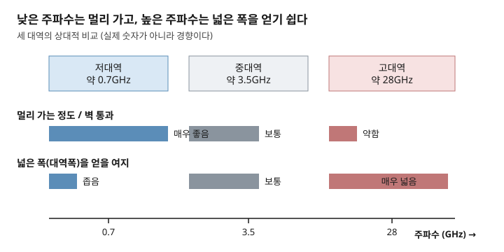
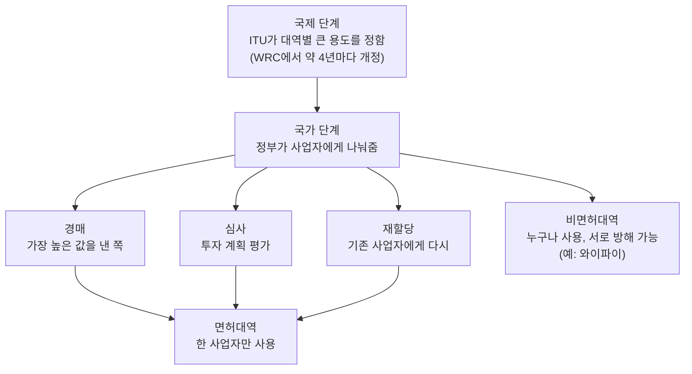

# 주간 통신 브리핑 — 2026-10-20

> 이번 주 배울 것: 낮은 주파수와 높은 주파수가 왜 서로 다르게 행동하는지, 그리고 그 주파수를 왜 국가가 나눠주는지 이해합니다.

*수집 공백 안내: 직전 리포트가 2026-09-22였습니다. 4주가 비어 있어서 그 사이(9월 말~10월 중순) 소식까지 범위를 넓혀 찾았습니다. 커리큘럼은 건너뛰지 않고 5·6번을 이어 갑니다.*

## 0. 30초 요약

- 주파수가 **낮을수록** 전파는 멀리 가고 벽을 잘 통과합니다. **높을수록** 빨리 약해지지만 넓은 폭을 얻기 쉽습니다.
- 그래서 이동통신은 낮은 대역, 중간 대역, 높은 대역을 섞어 씁니다.
- 같은 장소에서 같은 주파수를 두 곳이 쓰면 서로 방해합니다. 그래서 국가가 주파수를 나눠주고, 경매로 파는 나라도 많습니다.
- 이번 주 뉴스: 영국 규제기관이 6G 후보 대역 4곳 중 1곳만 지지하겠다고 밝혔습니다. 미국은 2027년 7월까지 160MHz를 경매합니다.

## 1. 지난주 복습

지난 리포트(09-22)에서는 주파수와 대역폭을 배웠습니다.
주파수는 전파가 1초에 몇 번 출렁이는지를 뜻하고, 파장은 물결 하나의 길이입니다.
대역폭은 통신에 쓰는 주파수 범위의 폭이고, 넓을수록 한 번에 더 많은 데이터를 보냅니다.

**확인 문제**: 5G가 LTE보다 빠른 이유 중 하나는 무엇이었을까요?
정답: 더 넓은 대역폭을 쓰기 때문입니다. (지난 리포트 3절 참고)

---

## 2. 이번 주 개념 ① — 주파수 대역별 성질

### 문제부터
통신사는 왜 한 가지 주파수만 쓰지 않을까요?
빠른 주파수만 쓰면 될 것 같지만, 그렇게 하면 기지국을 엄청나게 많이 세워야 합니다.
반대로 멀리 가는 주파수만 쓰면 속도가 안 나옵니다.
이 두 사정을 모르면 "왜 우리 집 안에서는 5G가 약한지"를 설명할 수 없습니다.

### 정의
주파수 대역별 성질이란, 주파수가 높고 낮음에 따라 전파가 가는 거리와 장애물을 통과하는 힘이 달라지는 특성입니다.
이 리포트에서는 편의상 약 1GHz 아래를 저대역, 1~6GHz 부근을 중대역, 24GHz 이상을 고대역이라 부릅니다.

### 동작 원리
옆집 음악 소리를 떠올려 보세요. 벽 너머로는 쿵쿵거리는 낮은 소리만 들립니다.
전파도 비슷한 경향을 보입니다. 다만 실제 이유는 소리와 별개로 두 가지입니다.

첫째, **감쇠**(신호가 퍼지며 약해지는 정도)가 주파수에 따라 커집니다.
같은 안테나 조건의 빈 공간에서는 주파수가 10배 높으면 받는 신호가 약 100배 약해집니다.
3.5GHz에서 28GHz로 가면 주파수가 8배이므로 약 64배 약해집니다.
둘째, 벽·유리·사람 몸에 흡수되고 막히는 정도도 주파수가 높을수록 커집니다.
파장이 짧을수록 작은 장애물에도 길이 막히기 때문입니다.

반면 넓은 폭은 높은 대역에 있습니다.
낮은 대역은 이미 방송·통신이 오래 써서 빈 자리가 좁습니다.
28GHz 부근은 아직 비어 있어서 한 번에 아주 넓은 폭을 쓸 수 있습니다.

**이 그림에서 볼 것**: 오른쪽(높은 주파수)으로 갈수록 "멀리 가는 정도" 막대는 줄고 "넓은 폭" 막대는 늘어납니다.

| 대역 | 대표 주파수 | 멀리 가는 정도 | 넓은 폭 확보 | 주 용도 |
|---|---|---|---|---|
| 저대역 | 약 0.7GHz | 매우 좋음 | 좁음 | 넓은 지역·실내 깊숙이 |
| 중대역 | 약 3.5GHz | 보통 | 보통 | 5G 주력, 도심 |
| 고대역 | 약 28GHz | 약함 | 매우 넓음 | 좁은 구역의 초고속 |

### 체감 사례
집 와이파이를 보면 바로 알 수 있습니다.
2.4GHz는 방을 몇 개 지나도 연결되지만 속도가 느립니다.
5GHz는 같은 방 안에서는 빠르지만 벽 두세 개를 지나면 확 약해집니다.
스마트폰 5G가 엘리베이터나 지하에서 LTE로 바뀌는 것도 비슷한 이유입니다.

### 흔한 오해
"높은 주파수는 빠르고 낮은 주파수는 느리다"는 말은 반만 맞습니다.
속도를 정하는 것은 주파수 숫자가 아니라 대역폭입니다.
높은 대역은 넓은 폭을 얻기 쉬워서 결과적으로 빠를 뿐입니다.
같은 폭이라면 낮은 대역이 더 멀리 갑니다.

### 한 줄 정리
결국 대역별 성질이란, 낮은 주파수는 멀리·깊이 가고 높은 주파수는 가까이에서 넓게 쓰는 서로 다른 장단점입니다.

지난 리포트에서 배운 대역폭이 "얼마나 넓은 도로인가"라면, 이번 개념은 "그 도로가 어디까지 이어지는가"를 알려줍니다.

---

## 3. 이번 주 개념 ② — 주파수는 왜 국가가 나눠주는가

### 문제부터
전파는 눈에 보이지 않고 벽도 못 가둡니다.
같은 동네에서 두 회사가 같은 주파수로 동시에 쏘면 서로 섞여서 둘 다 못 알아듣게 됩니다.
누군가 "여기서는 이 회사가 이 주파수만 쓰라"고 정해주지 않으면 통신 자체가 불가능합니다.

### 정의
주파수 할당이란, 정부가 특정 대역을 특정 사업자나 용도에 쓰도록 권리를 정해주는 일입니다.
한국에서는 과학기술정보통신부가 맡습니다.

### 동작 원리
전파 간섭은 같은 시간·장소·주파수가 겹칠 때 생깁니다.
이 셋 중 주파수를 미리 갈라두는 것이 가장 단순한 해법입니다.
그래서 두 단계로 나눕니다.

첫째, 국제 단계입니다. 국제전기통신연합(International Telecommunication Union, ITU)이 대역별 용도를 큰 틀에서 정합니다.
약 4년마다 열리는 세계전파통신회의(World Radiocommunication Conference, WRC)에서 바뀝니다.
국경 근처나 위성 신호는 나라끼리 맞춰야 하기 때문입니다.
둘째, 국가 단계입니다. 각 나라가 그 틀 안에서 사업자에게 나눠줍니다.
나눠주는 방식은 크게 셋입니다.

- **경매**: 가장 높은 값을 낸 사업자가 이용권을 얻습니다.
- **심사**: 투자 계획 등을 평가해 줍니다.
- **재할당**: 이용 기간이 끝난 대역을 기존 사업자에게 다시 줍니다. 값은 정부가 정한 기준으로 매깁니다.

이렇게 나눠준 대역을 **면허대역**이라 합니다.
와이파이 2.4GHz·5GHz처럼 누구나 쓰는 대역은 **비면허대역**입니다.
비면허대역은 면허가 없어서 이웃집 공유기와 전자레인지가 서로 방해합니다.

**이 그림에서 볼 것**: 위에서 아래로 갈수록 권리가 구체적으로 좁아집니다. 오른쪽 끝의 비면허대역만 "허락 없이" 쓸 수 있습니다.

### 체감 사례
통신 3사는 각자 면허대역을 정부에서 사 와서 씁니다. 그래서 같은 대역을 두 회사가 동시에 쏘지 않습니다.
반면 카페 와이파이가 사람이 많을 때 느려지는 것은 비면허대역을 모두가 함께 쓰기 때문입니다.
한국은 2026년에 끝나는 이동통신 주파수 370MHz폭 전체를 기존 사업자에게 재할당하기로 2025년 6월 결정했습니다.

### 흔한 오해
"주파수 경매는 정부가 돈을 벌려는 제도"라고 오해하기 쉽습니다.
돈은 부수 효과이고, 본래 목적은 가장 쓸모 있게 쓸 사업자에게 한정된 자원을 넘기는 것입니다.
다만 값이 너무 비싸면 사업자의 투자 여력이 줄어드는 부작용이 있어서 값 정하기를 두고 논란이 큽니다.

### 한 줄 정리
결국 주파수 할당이란, 눈에 안 보이는 한정된 자원을 서로 방해하지 않게 국가가 구획을 나눠 쓰게 하는 일입니다.

개념 ①에서 배운 "대역마다 성질이 다르다"는 사실 때문에, 어느 대역을 누구에게 주느냐가 곧 통신 품질의 차이가 됩니다.

---

## 4. 개념으로 읽는 이번 주 뉴스

### ① 영국 Ofcom, WRC-27에서 6G 후보 대역 4곳 중 1곳(7GHz 부근 125MHz)만 지지 제안 ★★

- **쉬운 설명**: 영국 통신 규제기관 Ofcom이 2026년 9월 1일 의견 수렴을 시작했습니다. 2027년 세계전파통신회의(WRC-27)에서 이동통신용으로 검토할 주파수 4곳 중 3곳은 반대하겠다는 방향입니다. 지지하려는 곳은 7.125~7.25GHz 한 곳, 폭 125MHz입니다. 의견은 11월 24일까지 받고, 모든 입장은 잠정안입니다. 유럽 쪽 해석에 따르면 이 대역은 와이파이와 6G가 나눠 쓰는 문제와 엮여 있습니다.
- **개념 ①·②와의 연결**: 7GHz 부근은 개념 ①의 중대역과 고대역 사이에 있어 "도달 거리와 폭의 균형점"입니다. 어느 대역을 6G에 줄지 국제회의에서 정하는 것이 개념 ②의 국제 단계입니다.
- **원문 링크(발행일 2026-09-01 확인)**: [Bratby Law "WRC-27: the UK proposes to oppose IMT identification in three of four bands"](https://bratby.law/wrc-27-uk-imt-identification-four-bands/), 보도: [ISPreview](https://www.ispreview.co.uk/?p=47930)

### ② 미국 FCC, 3.98~4.14GHz 160MHz 경매 규칙 확정(2026-07-22) ★★

- **쉬운 설명**: 미국 FCC가 2026년 7월 22일 규칙을 확정했습니다. 2027년 7월까지 160MHz폭을 경매합니다. 이미 쓰는 아래쪽 대역과 붙이면 440MHz 폭의 넓은 대역이 됩니다. 낙찰자는 큰 도시 75곳부터 2030년 12월 이후, 그 밖의 지역은 2031년 7월 이후 서비스를 시작할 수 있습니다. 직전 리포트(09-22)에서 소개한 FCC 경매 소식의 구체적 규칙입니다. 이번 달 새 발표는 아니며, 개념 설명용 배경으로 넣었습니다.
- **개념 ①·②와의 연결**: 4GHz 안팎은 개념 ①의 중대역이라 도심 5G에 알맞습니다. 정부가 값을 받고 이용권을 파는 것이 개념 ②의 경매입니다.
- **원문 링크(규칙 채택 2026-07-22)**: [Benton Institute "FCC Proposes Upper C-Band Rules for 2027 Auction"](https://www.benton.org/headlines/fcc-proposes-upper-c-band-rules-2027-auction)

### ③ 한국, 2026년 만료 주파수 370MHz 전량 재할당 — 대가 논란 ★

- **쉬운 설명**: 과기정통부가 2025년 6월 30일 결정했습니다. 2026년 6월과 12월에 끝나는 3G·LTE 대역 370MHz를 기존 사업자에게 모두 다시 줍니다. 2025년 12월 기사에 따르면 2.6GHz 대역의 값을 놓고 SK텔레콤과 LG유플러스가 부딪혔습니다. SK텔레콤은 2016년 경매에서 60MHz를 1조 2777억 원에, LG유플러스는 2013년에 40MHz를 4788억 원에 받았습니다. 같은 대역인데 1MHz당 연간 비용이 약 2배 차이 납니다. 최종 확정 내용은 이번 검색에서 확인하지 못했습니다.
- **개념 ②와의 연결**: 재할당은 이용 기간이 끝난 면허대역을 다시 주는 방식이고, 그 값을 어떻게 정할지가 핵심 쟁점입니다.
- **원문 링크(결정 2025-06-30, 갈등 기사 2025-12-02)**: [달리안 "과기정통부, 2026년 만료 이동통신 주파수 370㎒ 전량 재할당 결정"](https://www.dailian.co.kr/news/view/1516576/%EA%B3%BC%EA%B8%B0%EC%A0%95%ED%86%B5%EB%B6%80-2026%EB%85%84-%EB%A7%8C%EB%A3%8C-%EC%9D%B4%EB%8F%99%ED%86%B5%EC%8B%A0-2025), [다음뉴스 "2.6GHz 재할당 앞두고 통신 3사 동상이몽"](https://v.daum.net/v/20251202183714491)

## 5. 그 밖의 소식

- **TTA ICT Standard Weekly 제1312호**: "방송 장르마다 다른 AI, 그래서 다른 표준이 필요하다" — 이번 개념과 무관한 방송·AI 표준 주제. [TTA 위클리 목록](https://committee.tta.or.kr/data/weekly_list.jsp) (제목만 확보, 발행일은 확인 못함)
- **IITP 주간기술동향 제2222호(2026-10-07)**: 로봇 플랫폼, 휴머노이드 VLA, 바이브코딩 품질관리 — 통신 주제는 없음. [itfind 목록](https://www.itfind.or.kr/publication/regular/weeklytrend/weekly/list.do)
- **Network X 2026(2026-10-13~15, 오스트리아 빈)**: 통신사·장비사 행사. 행사 일정만 확인했고, 행사 결과 기사는 아직 찾지 못했습니다.

## 6. 이해 점검 퀴즈

**Q1.** 같은 조건에서 주파수가 높아질수록 받는 신호는 어떻게 되는가?
a) 더 강해진다 b) 변화 없다 c) 더 약해진다 d) 사라진다

**Q2.** 집 와이파이에서 방을 몇 개 지나도 연결이 잘 되는 쪽은?
a) 2.4GHz b) 5GHz c) 둘 다 같다 d) 알 수 없다

**Q3.** 28GHz 같은 고대역을 쓰는 가장 큰 이유는?
a) 멀리 가서 b) 넓은 폭을 얻기 쉬워서 c) 벽을 잘 통과해서 d) 기지국이 적게 필요해서

**Q4.** 사람이 많은 카페에서 와이파이가 느려지는 이유와 가장 관련 있는 것은?
a) 면허대역을 비싸게 사서 b) 비면허대역을 모두가 함께 써서 c) 경매에서 졌기 때문에 d) 재할당이 끝나서

**Q5.** 이용 기간이 끝난 면허대역을 기존 사업자에게 다시 주는 방식은?
a) 경매 b) 심사 c) 재할당 d) 비면허

### 정답과 해설

1. **정답 c**. 빈 공간에서도 주파수가 높을수록 신호가 더 약해집니다. 10배 높으면 약 100배 약해집니다. (2절 '동작 원리' 참고)
2. **정답 a**. 2.4GHz는 벽을 지나도 잘 가지만 느립니다. 5GHz는 빠르지만 벽에 약합니다. (2절 '체감 사례' 참고)
3. **정답 b**. 고대역은 비어 있는 자리가 많아 한 번에 넓은 폭을 쓸 수 있습니다. (2절 '동작 원리' 참고)
4. **정답 b**. 비면허대역은 누구나 쓸 수 있어서 사용자가 많으면 서로 방해합니다. (3절 '동작 원리'와 '체감 사례' 참고)
5. **정답 c**. 재할당은 끝나는 면허대역을 기존 사업자에게 다시 주는 방식입니다. (3절 '동작 원리' 참고)

## 7. 이번 주 용어집

- **감쇠** — 전파가 퍼지거나 장애물을 지나며 약해지는 정도.
- **국제전기통신연합(International Telecommunication Union, ITU)** — 대역별 용도를 큰 틀에서 정하는 국제기구.
- **면허대역** — 정부에게 이용권을 받아야 쓸 수 있는 대역. 이동통신이 쓴다.
- **비면허대역** — 허락 없이 누구나 쓰는 대역. 와이파이가 대표적이다.
- **세계전파통신회의(World Radiocommunication Conference, WRC)** — 약 4년마다 열려 국제 주파수 용도를 고치는 회의. 다음은 2027년 가을 중국 상하이.
- **재할당** — 이용 기간이 끝난 면허대역을 기존 사업자에게 다시 주는 것.
- **저대역·중대역·고대역** — 이 리포트에서 약 1GHz 아래, 1~6GHz 부근, 24GHz 이상을 부르는 이름. 공식 구분은 자료마다 조금 다르다.

## 8. 다음 주 예고

- 커리큘럼 7번 **신호 세기와 잡음**을 다룰 예정입니다. 스마트폰 안테나 막대기의 정체인 dBm이 무엇인지 알아봅니다.
- 8번 **변조**(0과 1을 전파에 싣는 법)도 이어서 다룹니다.
- Ofcom의 WRC-27 의견 수렴은 11월 24일에 끝납니다. 이후 결과를 확인합니다.
- 한국 2026년 12월 만료 대역의 재할당 최종 대가는 아직 확인하지 못했습니다. 발표되면 다시 다룹니다.

## 부록: 이번 주 수집 상태

| 소스 | 상태 | 비고 |
|---|---|---|
| TTA ICT Standard Weekly | 목록 성공 | 제1312호 제목 확보. 발행일은 목록에서 확인 안 됨, 본문 PDF는 차단 |
| IITP 주간기술동향 | 성공 | 제2222호(2026-10-07). 통신 기사 없음, 리포트 미반영 |
| arXiv | 시도하지 않음 | 이번 주 개념(전파 전파 특성·주파수 정책)과 바로 이어지는 논문이 필요하지 않아 생략 |
| 3GPP/ITU | 검색으로 확인 | 10월 신규 3GPP 이정표는 검색에서 찾지 못함. Ofcom의 WRC-27 의견 수렴(ITU 관련)은 확인 |
| IEEE 계열 | 시도하지 않음 | 6주 연속 차단 상태로 간주, 이번에는 시도 생략 |
| 뉴스 검색 | 부분 성공 | 10월 날짜가 확인된 통신 뉴스가 부족했음. 날짜가 확인되는 항목만 사용. www.ispreview.co.uk는 WebFetch 접근 불가(ENOTFOUND), 검색 스니펫으로 확인 |
